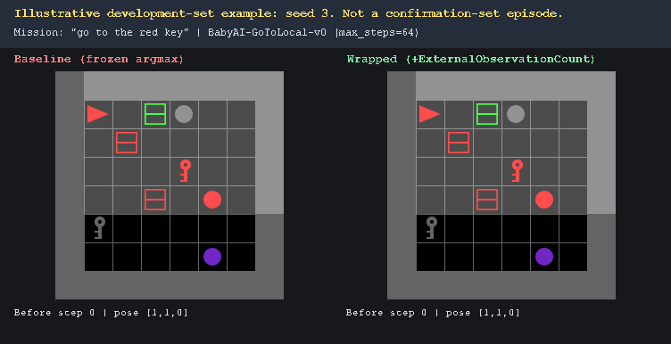

# Your Game Bot Is Stuck. Does It Really Need Retraining?

A frozen policy, a small action-history wrapper, and 200 unseen BabyAI episodes.

Reproduce the result—or help find where it breaks.



*An illustrative development-set example (seed 3, not a confirmation episode): the baseline gets stuck; the wrapped bot finishes in 11 steps.*

## Same policy. More completed episodes.

On 200 previously unused BabyAI episodes, the wrapper increased
successes from **181 to 196**, without additional expert labels
or retraining.

It remembers which actions have been tried at each observation and
prioritizes less-tried actions, using the policy's preferences to break ties.
The policy was trained beforehand on expert demonstrations and stays frozen; the execution layer adds memory.

This is one discrete task—not a general fix for game bots.
Whether the wrapper harms legitimate revisits remains untested, and this study does not evaluate Laya or DSR.

[Reproduce it](#reproduce-in-an-isolated-directory) ·
[Inspect the evidence](docs/reports/phase5_confirmation_report.md) ·
[Help find where it breaks](contributions/02_harmful_legitimate_revisit.md)

---

## Result Details, Mechanism, and Scope

- **Confirmation breakdown (`30000..30199`, `N = 200`, `max_steps = 64`):** `181/200` (`90.50%`) frozen baseline vs. `196/200` (`98.00%`) wrapped — `181` both succeed, `15` wrapper-only wins, `0` regressions, `4` both fail (`+7.5` percentage points, Newcombe Method 10 95% CI `[+0.039486, +0.120391]`, exact two-sided McNemar `p = 6.10352e-05`). See [Public Phase 5 Report](docs/reports/phase5_confirmation_report.md), [Results JSON](phase5_confirmation_results.json), [Episode JSONL](phase5_confirmation_episodes.jsonl), and [STATUS.md](STATUS.md).
- **Wrapper specification ([`external_wrapper.py`](external_wrapper.py)):** Consumes only public `(obs['image'], obs['mission'])`, frozen action probabilities, and `reset()`. Keys counts by `(bytes(obs['image']), str(obs['mission']))` within an episode and picks the lexicographic minimum `(issued_count, -base_prob, action_id)` over `{left, right, forward}`.
- **Illustrative seed-3 trace ([4-frame PNG strip](demo/seed3_keyframes.png), [demo metadata](demo/seed3_demo_metadata.json)):** Baseline enters a blocked-forward loop at step `2` and times out at `64`; Wrapped overrides `forward -> right` once at `0`-indexed decision step `3` (`prior_counts = [0, 0, 1]`) and finishes in `11` steps. Not a confirmation-set recording or effect-size estimate.
- **Model & task scope:** Evaluates one frozen `247 -> 64 (ReLU) -> 3` NumPy MLP (`phase1_weights.npz`) in discrete [`BabyAI-GoToLocal-v0`](https://minigrid.farama.org/environments/babyai/goto/), relying on exact byte-identical MiniGrid observations. Zero of `181` baseline-successful confirmation runs repeated a raw observation (`0` overrides on baseline wins).
- **Training provenance, provenance note & engineering cost:** [`phase1_weights.npz`](phase1_weights.npz) was pre-trained offline on `499` `BabyAIBot` demonstrations (`2,656` filtered samples, seeds `10000..10499`, epoch `21` selected on `20000..20099`; [Public Phase 1 Report](docs/reports/phase1_report.md)). The Phase 4 wrapper evaluation and Phase 5 confirmation used the original frozen Phase 1 checkpoint, with no additional expert queries or retraining. Phase 3 was a separate exploratory retraining experiment (DAgger-1 reached `95/100` on dev `0..99` vs. `93/100` baseline and `98/100` wrapped, and was excluded from confirmation; [Phase 3](docs/reports/phase3_report.md), [Phase 4](docs/reports/phase4_report.md)). **Human development cost was not measured**, and Confirmation reflects one completed evaluation after fixing a pre-flight `NameError` (`gym.__version__`, Section 7 of [Public Phase 5 Report](docs/reports/phase5_confirmation_report.md)). Google Antigravity assisted development.
- **More ways to contribute:** [Brief 1: Reproduce the result](contributions/01_reproduce_published_result.md) · [Brief 3: Simpler escape baselines](contributions/03_simpler_escape_baselines.md) · [Contributing Guide](CONTRIBUTING.md)

---

## Reproduce in an Isolated Directory

### Setup (`Windows x86_64`, `Python 3.14.3`)
Pinned dependencies live in [`requirements.txt`](requirements.txt) (locked on Windows `Python 3.14.3`, not yet tested on Linux/macOS):

```powershell
uv venv .venv --python 3.14
uv pip install --python .venv/Scripts/python.exe --no-build -r requirements.txt
```

### Non-Destructive Checks and Isolated Reproduction
[`run_phase5_confirmation.py`](run_phase5_confirmation.py) accepts no CLI flags and overwrites `phase5_confirmation_episodes.jsonl` and `phase5_confirmation_results.json` if run directly in the root. Use [`reproduce_confirmation.py`](reproduce_confirmation.py) to stage only the `8` frozen inputs into a new directory and preserve all SHA-256 and package version checks:

```powershell
# Non-episode synthetic & launcher tests
.venv\Scripts\python.exe phase5_stats.py
.venv\Scripts\python.exe -c "import json; from external_wrapper import run_wrapper_unit_tests; print(json.dumps(run_wrapper_unit_tests(), indent=2))"
.venv\Scripts\python.exe -m unittest -v tests.test_reproduce_confirmation

# Stage-check without running episodes, then run all 200 public-seed pairs in repro_runs/run1 (~1 s CPU)
.venv\Scripts\python.exe reproduce_confirmation.py --dest repro_runs/run1 --dry-run
.venv\Scripts\python.exe reproduce_confirmation.py --dest repro_runs/run1
```

*Holdout rule:* Seeds `30000..30199` are now a public reproduction set—running this reproduces published outputs and does not establish a new confirmation claim. New baselines or ablations belong under a separate folder (`experiments/<name>/`) on fresh evaluation seeds; see [`CONTRIBUTING.md`](CONTRIBUTING.md).

---

## Project Map

| Area | Key Files |
| :--- | :--- |
| **Policy, Wrapper & Stats** | [run_phase1.py](run_phase1.py), [phase1_weights.npz](phase1_weights.npz), [phase1_config.json](phase1_config.json), [external_wrapper.py](external_wrapper.py), [phase5_stats.py](phase5_stats.py) |
| **Confirmation & Launcher** | [phase5_confirmation_plan.json](phase5_confirmation_plan.json), [run_phase5_confirmation.py](run_phase5_confirmation.py), [reproduce_confirmation.py](reproduce_confirmation.py), [tests/test_reproduce_confirmation.py](tests/test_reproduce_confirmation.py), [phase5_confirmation_results.json](phase5_confirmation_results.json), [phase5_confirmation_episodes.jsonl](phase5_confirmation_episodes.jsonl) |
| **Public Reports (Phases 0–5)** | [phase0_report.md](phase0_report.md), [Phase 1](docs/reports/phase1_report.md), [Phase 2](docs/reports/phase2_report.md), [Phase 3](docs/reports/phase3_report.md), [Phase 4](docs/reports/phase4_report.md), [Phase 5](docs/reports/phase5_confirmation_report.md) |
| **Dev Seed-3 Visual Demo** | [run_seed3_demo.py](run_seed3_demo.py), [seed3_baseline_vs_wrapper.gif](demo/seed3_baseline_vs_wrapper.gif), [seed3_keyframes.png](demo/seed3_keyframes.png), [seed3_demo_metadata.json](demo/seed3_demo_metadata.json) |
| **Contributing & Release State** | [CONTRIBUTING.md](CONTRIBUTING.md), [STATUS.md](STATUS.md), [PUBLICATION_MANIFEST.md](PUBLICATION_MANIFEST.md), [contributions/](contributions), [requirements.txt](requirements.txt), [LICENSE](LICENSE), [THIRD_PARTY_NOTICES.md](THIRD_PARTY_NOTICES.md), [.gitignore](.gitignore) |

---

## Related Interactive Demo

A separate Godot/Laya playground lets you play a BabyAI-style room and inspect recorded Laya failures. It does not use this repository’s NumPy policy or action-history wrapper, and it is not the source of the 181/200 → 196/200 result.

[Play the separate Laya demo](https://mokaflow.itch.io/babyai-laya-an-ai-in-the-room)

---

## License

Original repository material that the author has the rights to license—including original Python code, documentation, the [`phase1_weights.npz`](phase1_weights.npz) checkpoint, and original evaluation artifacts—is licensed under the [MIT License](LICENSE) (`Copyright (c) 2026 Mark Sol`), except where third-party upstream rights or notices apply. See [THIRD_PARTY_NOTICES.md](THIRD_PARTY_NOTICES.md) for verified upstream attribution, `minigrid` license-notice details, and third-party dependency exceptions.

*Optional courtesy request (non-binding; adds no conditions to the MIT License and does not require notification, citation, backlinks, or source disclosure):*

> If this project helps your work, a link back or a short note about your results would be appreciated. Replications, counterexamples, and corrections are especially welcome.
